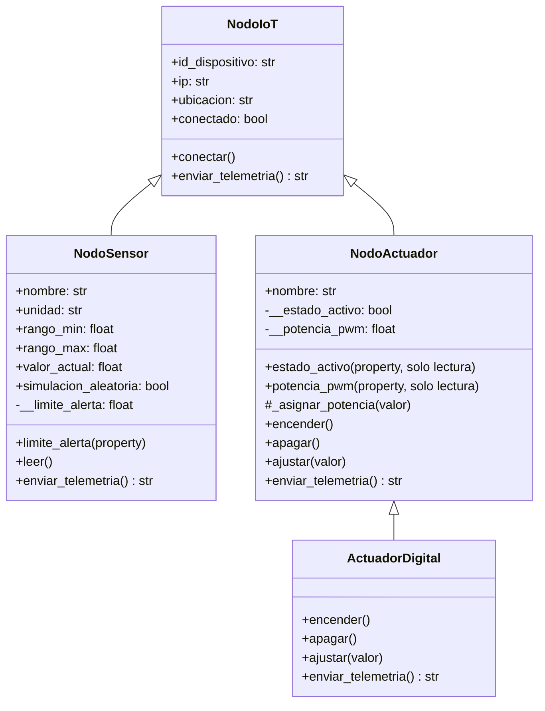

# Práctica 2 — Sistema Modular de Nodos IoT (Herencia y Polimorfismo)

Segunda versión del simulador del reactor químico de la Práctica 1. En lugar de tener `Sensor` y `Actuador` como clases independientes, ahora todos los dispositivos **heredan de una clase base `NodoIoT`** que representa un nodo de red (id, IP, ubicación y estado de conexión). Sobre esa base se construyen sensores y actuadores, y el panel de control (HMI) los trata a todos por igual gracias al **polimorfismo**.

## Estructura de la carpeta

```text
practica-02/
├── README.md
├── UML_Practica2.pdf        # Diagrama de clases de la práctica
└── src/
    └── reactor_sim_2.py     # Simulador en Python (consola)
```

## Diagrama de clases

El diagrama completo está en [`UML_Practica2.pdf`](UML_Practica2.pdf). Resumen de la jerarquía:



> `ActuadorDigital` extiende a `NodoActuador` en el código; el PDF del UML muestra las tres clases principales (`NodoIoT`, `NodoSensor` y `NodoActuador`).

## Clases

| Clase | Hereda de | Responsabilidad |
| :--- | :--- | :--- |
| `NodoIoT` | — | Datos de red del dispositivo (`id_dispositivo`, `ip`, `ubicacion`), `conectar()` y la telemetría base (`ONLINE` / `OFFLINE`). |
| `NodoSensor` | `NodoIoT` | Sensor con rango de medición, valor actual y límite de alerta validado. `leer()` simula una lectura aleatoria dentro del rango solo si `simulacion_aleatoria` es `True`; si es `False`, conserva el valor que le asigna el modo AUTO. |
| `NodoActuador` | `NodoIoT` | Actuador proporcional: potencia PWM de 0 a 100 %, con `encender()`, `apagar()` y `ajustar(valor)`. Su estado y potencia se leen mediante propiedades de solo lectura. |
| `ActuadorDigital` | `NodoActuador` | Actuador de dos estados (0 o 1), por ejemplo una válvula todo/nada. Rechaza cualquier valor distinto de 0 o 1. |

## Conceptos de POO aplicados

- **Herencia:** `NodoSensor` y `NodoActuador` reutilizan los atributos y métodos de `NodoIoT` mediante `super()`. `ActuadorDigital` especializa a `NodoActuador`.
- **Encapsulamiento:** `__limite_alerta`, `__estado_activo` y `__potencia_pwm` son atributos privados. El límite de alerta se maneja con `@property` y su *setter*, que lanza `TypeError` si el valor no es numérico y `ValueError` si queda fuera de `[rango_min, rango_max]`. El estado y la potencia del actuador solo se leen con `@property` (sin *setter*): únicamente cambian mediante `encender()`, `apagar()` y `ajustar()`. `ActuadorDigital` modifica la potencia privada a través del método protegido `_asignar_potencia()`.
- **Polimorfismo:** `enviar_telemetria()` está sobrescrito en cada clase. El bucle que dibuja el HMI recorre la lista `red_iot` y llama al mismo método en todos los nodos, sin `if/else` por tipo de dispositivo.

## Dispositivos simulados

| ID | Clase | Nombre | IP | Ubicación | Rango | Límite de alerta |
| :--- | :--- | :--- | :--- | :--- | :--- | :--- |
| `SEN-001` | `NodoSensor` | Termometro | 192.168.1.21 | Reactor | 0 – 150 °C | 85 °C |
| `SEN-002` | `NodoSensor` | Presion | 192.168.1.22 | Reactor | 0 – 15 Bar | 12 Bar |
| `ACT-001` | `NodoActuador` | Bomba | 192.168.1.11 | Enfriamiento | PWM 0 – 100 % | — |
| `ACT-002` | `ActuadorDigital` | Valvula | 192.168.1.12 | Alivio | 0 / 1 | — |

Cuando la lectura de un sensor supera su límite de alerta, la telemetría muestra `⚠ ALERTA`.

## Modos de operación

1. **MANUAL:** el operario escribe los comandos y controla directamente la bomba y la válvula.
2. **AUTO:** el sistema estabiliza la temperatura con un control proporcional sobre la bomba. En cada ciclo se calcula:
   - `error = temperatura − consigna` (consigna = 50 °C)
   - `PWM de la bomba = 30 + 2 × error`, limitado a 0 – 100 %
   - `ΔT = (+1.5 °C) − (0.05 °C × % de potencia de la bomba)`

   Con la bomba al 30 % el cambio de temperatura es cero, así que el sistema se estabiliza en 50 °C. En este modo el control manual queda bloqueado y se avanza un ciclo presionando **Enter**.

El termómetro no genera lecturas aleatorias (`simulacion_aleatoria=False`): su valor lo mueve el modo AUTO y arranca en 0 °C. La presión sí toma un valor aleatorio dentro de su rango cada vez que se lee.

El panel también muestra un **registro de eventos** con las últimas 5 acciones del sistema.

## Comandos de consola

| Comando | Descripción | Ejemplo |
| :--- | :--- | :--- |
| `modo <manual/auto>` | Cambia el modo de operación | `modo auto` |
| `encender <actuador>` | Enciende un actuador | `encender bomba` |
| `apagar <actuador>` | Apaga un actuador | `apagar valvula` |
| `ajustar <actuador> <valor>` | Ajusta la potencia (bomba: 0–100) o el estado (válvula: 0 o 1) | `ajustar bomba 75.5` |
| `leer <sensor>` | Toma una lectura del sensor | `leer presion` |
| `terminar` | Finaliza la simulación | `terminar` |

## Cómo ejecutarlo

Solo necesita Python 3 y la librería estándar (`os` y `random`). Desde la raíz del repositorio:

```bash
python practica-02/src/reactor_sim_2.py
```

Ejemplo de sesión:

```text
Ingrese comando >> ajustar bomba 75.5
Ingrese comando >> ajustar valvula 1
Ingrese comando >> modo auto
Ingrese comando >>                      (Enter avanza un ciclo)
Ingrese comando >> terminar
```

## Autores

Ver [`AUTHORS.md`](../AUTHORS.md) en la raíz del repositorio.
