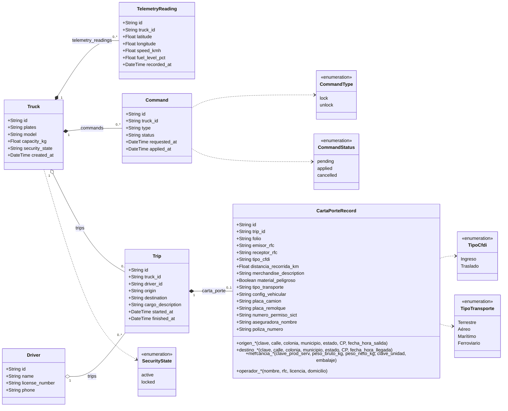

# FlotaTrack-EDSIA — Diagramas UML
## 1. Diagrama de clases (modelos SQLAlchemy)

> Los rombos rellenos (`*--`) indican composición: al borrar un `Truck` se borran sus lecturas y comandos, y al borrar un `Trip` se borra su carta porte (`cascade="all, delete-orphan"`). `CartaPorteRecord` tiene un solo registro por viaje (`trip_id` único). Los campos agrupados con `*` representan varias columnas del mismo bloque.

 Diagramas UML FORMATO .PNG

